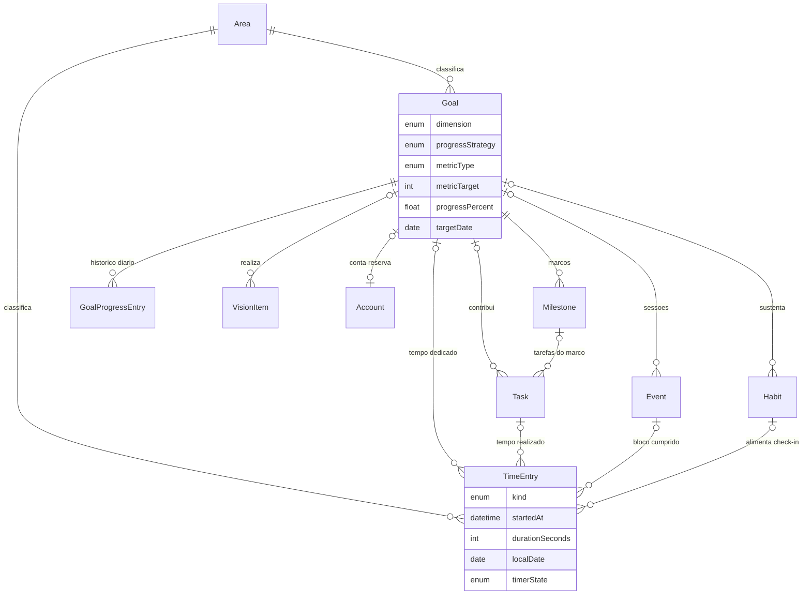
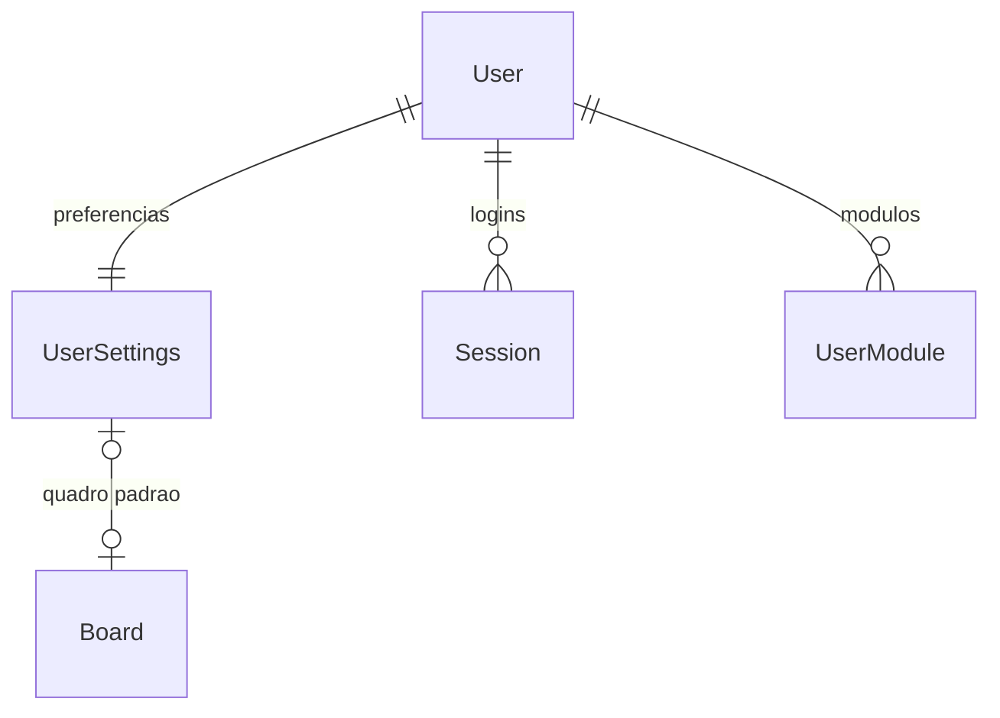
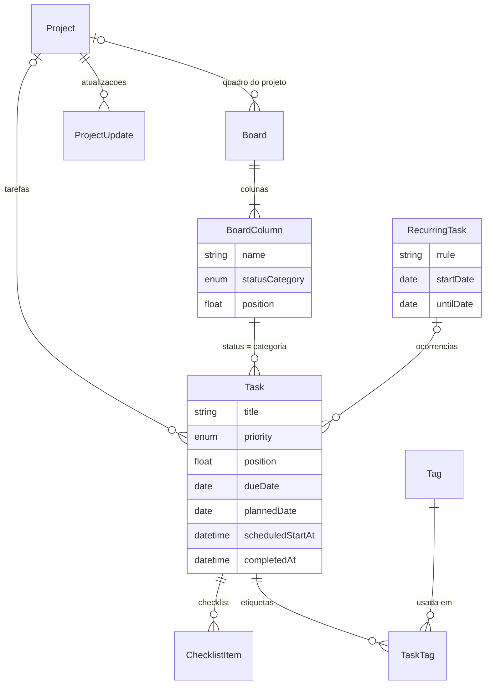
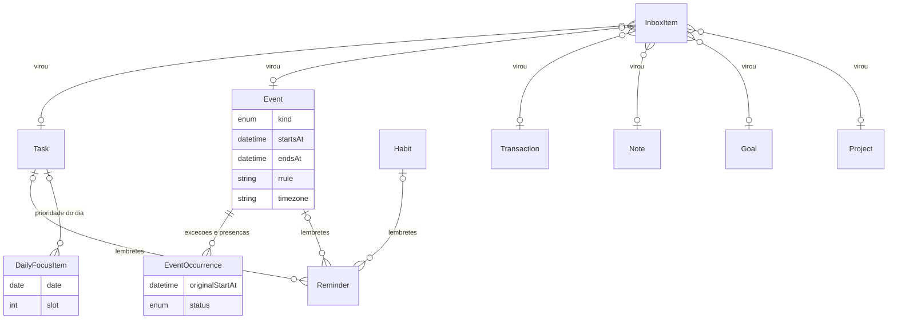
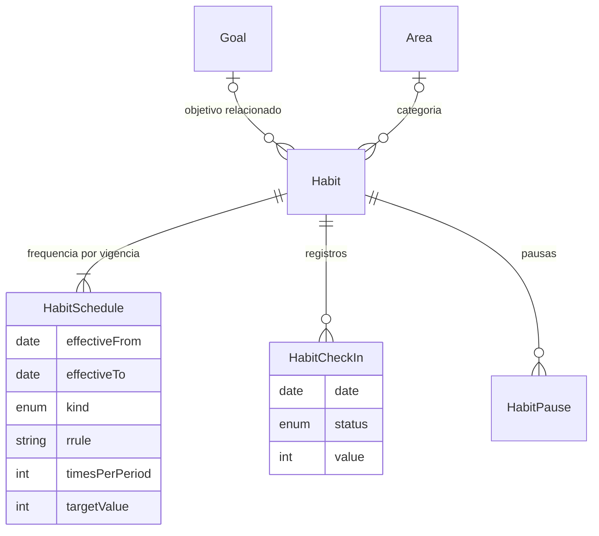
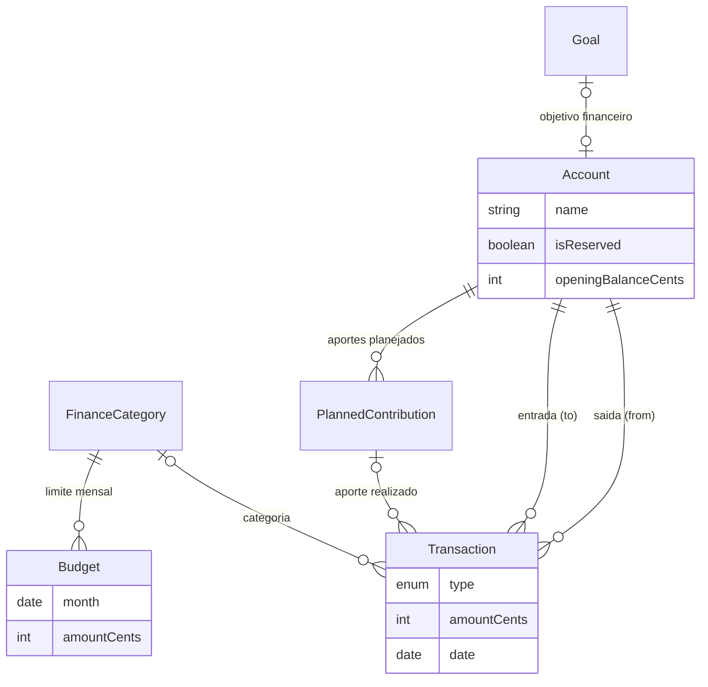
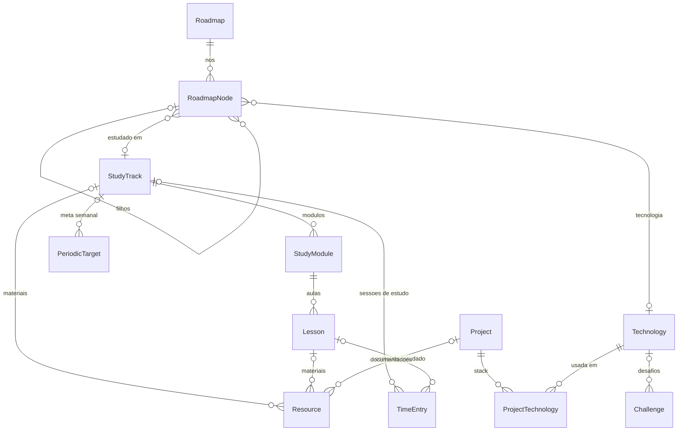
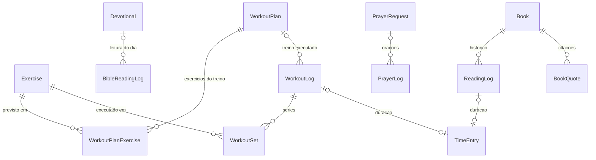
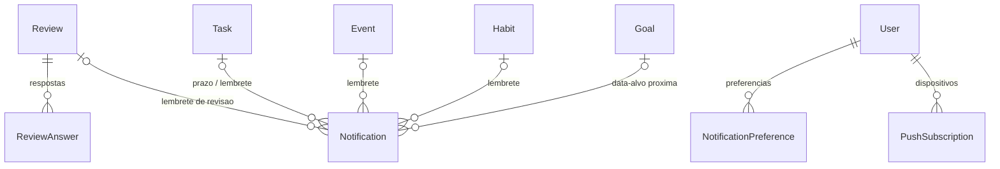

# RITMO — Modelo de dados

> **Status:** proposta para aprovação. Nada foi aplicado em banco de dados.
> **Schema completo:** [`docs/database/schema.draft.prisma`](database/schema.draft.prisma) — este documento explica o desenho; o arquivo é a fonte da verdade dos campos.

| | |
|---|---|
| Banco | MariaDB (provider `mysql` do Prisma) |
| ORM | **Prisma 7.10.1** (versão estável atual; ver nota abaixo) |
| Tamanho | **64 modelos, 44 enums**, 169 chaves estrangeiras |
| Validação | `prisma format` e `prisma validate` passam (saída na seção 9) |

**Nota sobre a versão do Prisma.** No npm, a tag `latest` do pacote `prisma` aponta hoje para `8.0.0-rc.33`, que é um *release candidate*; a 8.0.0 final ainda não existe, e `@prisma/client` continua com `latest = 7.10.1`. A versão estável é a 7. Ao instalar, fixe a versão (`prisma@7.10.1` e `@prisma/client@7.10.1`): um `npm install prisma` sem versão instalaria o RC.

No Prisma 7 o `schema.prisma` não contém mais a URL do banco. Ela fica em `apps/api/prisma.config.ts` (`datasource.url`), o gerador é `prisma-client` com `output` obrigatório, e o client é criado com o adapter `@prisma/adapter-mariadb`. O rascunho já está nesse formato.

---

## 1. Visão geral e princípios

O RITMO tem muitos módulos, mas o banco foi desenhado em torno de poucas tabelas centrais que todos os módulos usam. Um módulo novo quase nunca cria um conceito novo de "tempo", "categoria" ou "progresso": ele aponta para os que já existem.

1. **Tudo pertence a um usuário.** Toda tabela tem `userId` com exclusão em cascata a partir de `users`. Nenhuma linha é compartilhada entre usuários. Exportar ou apagar os dados de alguém é um `WHERE userId = ?` por tabela.
2. **Relacionamentos são chaves estrangeiras reais.** Não existe par `entityType/entityId` em nenhum lugar do schema, nem na Captura Rápida (ver seção 4.4).
3. **Só `CASCADE` e `SET NULL` entre tabelas do usuário, nunca `RESTRICT`.** No InnoDB, um `RESTRICT` no meio do caminho pode bloquear a exclusão do usuário dependendo da ordem em que o banco percorre as cascatas. Regras como "não excluir conta que tem movimentações" ficam no serviço, que oferece arquivar.
4. **Dinheiro é inteiro.** Valores em centavos (`*Cents`, `Int`), com coluna `currency` (padrão `BRL`). Nenhum `Float` em valor monetário.
5. **Instante é UTC; dia é dia.** Coisas que acontecem num momento usam `DateTime` em UTC. Coisas que pertencem a um dia do calendário (check-in de hábito, reflexão, devocional, leitura, orçamento do mês) usam coluna só de data. Horário do dia é guardado em minutos desde a meia-noite, no fuso do usuário. Fuso (IANA), idioma e primeiro dia da semana ficam em `user_settings`.
6. **Recorrência é uma regra, não uma pilha de linhas.** Guardamos a RRULE (RFC 5545) e calculamos as ocorrências na leitura. Só vira linha o que de fato aconteceu.
7. **Histórico não é reescrito.** Mudar a frequência de um hábito ou uma meta semanal cria uma nova versão com data de vigência; o passado continua sendo avaliado pela regra que valia na época. Revisões guardam um retrato congelado das métricas.
8. **Ausência não é punição.** Não existe estado "falhou" para hábito: dia não cumprido é simplesmente a falta de um registro. Sequências (streaks) e taxas são calculadas, nunca armazenadas.
9. **Valores derivados não são guardados**, com duas exceções documentadas (`Goal.progressPercent` e `Goal.lastActivityAt`). Saldo de conta, tempo realizado de tarefa, progresso de trilha e de livro saem de consulta.
10. **Identificadores em inglês, dados padrão em pt-BR.** Tabelas em `snake_case` minúsculo (funciona igual em Windows e Linux); nomes de áreas e categorias semeados em português.

**Convenções técnicas:** IDs são UUID v7 em `CHAR(36)` (ordenados por tempo, bons para o índice do InnoDB, não enumeráveis na API). Listas ordenáveis por arrastar usam `position Float` (inserir entre dois itens = média das posições). Todo índice de consulta por usuário começa com `userId`.

---

## 2. A espinha de integração

Sete peças fazem os módulos conversarem.

| Peça | O que resolve |
|---|---|
| **Area** | Uma única tabela de áreas da vida, usada por tarefas, compromissos, hábitos, objetivos, projetos e registros de tempo. "Como distribuo meu tempo" é um único `GROUP BY areaId`. |
| **TimeEntry** | O livro-razão do tempo dedicado. Sessão de estudo, de programação, prática de inglês, treino, leitura e tempo trabalhado em tarefa são todos linhas aqui. |
| **Goal + Milestone + GoalProgressEntry** | Objetivo com estratégia de progresso explícita (manual, por marcos ou por métrica) e histórico diário para o gráfico de evolução. |
| **Task × Event** | Tarefa é trabalho flexível (pode ganhar um bloco de horário); compromisso é horário fixo. Ambos apontam para área, objetivo, projeto e hábito. |
| **Recorrência (RRULE)** | Mesma forma de regra para compromissos, tarefas, hábitos e aportes planejados; uma única biblioteca de expansão. |
| **Board → Column → Task** | O status da tarefa é a categoria da coluna onde ela está. Lista e Kanban leem o mesmo dado. |
| **Account + Transaction** | Dinheiro reservado separado do disponível; transferência é uma linha só e nunca vira receita ou despesa. Objetivo financeiro é um `Goal` ligado a uma conta-reserva. |

### 2.1 Exemplo 1 — "Conversar em inglês com confiança até dezembro de 2027"

| O que o brief pede | Onde fica |
|---|---|
| Objetivo com data-alvo | `goals`: `dimension = INTELLECTUAL`, `areaId →` área Inglês, `targetDate = 2027-12-31`, `progressStrategy = MILESTONES` |
| Marcos intermediários | `milestones` (`goalId`, `weight`, `completedAt`). Tarefas podem apontar para um marco (`tasks.milestoneId`), então cada marco tem seu próprio andamento |
| Hábitos associados | `habits.goalId` → "Estudar inglês"; a frequência fica em `habit_schedules` (`FREQ=WEEKLY;BYDAY=MO,WE,FR`) |
| Sessões de estudo na agenda | `events`: `kind = TIME_BLOCK`, `rrule`, com `goalId`, `habitId` e `areaId` preenchidos |
| Tempo dedicado | `time_entries`: `kind = ENGLISH`, `englishSkill = SPEAKING`, `goalId`, `habitId`, `eventId`, `durationSeconds` |
| Progresso | `goals.progressPercent` recalculado a cada marco concluído; cada mudança grava o ponto do dia em `goal_progress_entries` |
| Consistência semanal | `habit_check_ins` por semana comparados ao esperado por `habit_schedules`; minutos por semana em `time_entries` |
| Quão perto está | `progressPercent` + `targetDate` + ritmo dos últimos pontos de `goal_progress_entries` |

O encadeamento em uso: o usuário inicia o cronômetro a partir do bloco da agenda. Nasce um `TimeEntry` que copia área, objetivo e hábito do bloco. Ao finalizar, o serviço marca a ocorrência como cumprida (`event_occurrences`), registra o check-in do hábito do dia e atualiza `goals.lastActivityAt`. Um gesto do usuário alimenta agenda, hábito, objetivo e revisão semanal.

### 2.2 Exemplo 2 — "Economizar R$ 10.000"

| O que o brief pede | Onde fica |
|---|---|
| Objetivo financeiro | `goals`: `dimension = FINANCIAL`, `progressStrategy = METRIC`, `metricType = MONEY_ACCUMULATED`, `metricTarget = 1000000` (centavos), `reserveAccountId →` conta |
| Valor atual reservado | Saldo da conta-reserva (`accounts.isReserved = true`): saldo inicial + entradas − saídas em `transactions` |
| Valor desejado e prazo | `goals.metricTarget` e `goals.targetDate` |
| Aportes planejados | `planned_contributions`: conta de destino, valor, `rrule = FREQ=MONTHLY;BYMONTHDAY=5` |
| Histórico de movimentações | `transactions` com `toAccountId` ou `fromAccountId` = conta-reserva (`RESERVE_CONTRIBUTION`, `RESERVE_WITHDRAWAL`). O aporte que cumpre um planejado guarda `plannedContributionId` + `plannedDate` |
| Projeção de conclusão | (alvo − saldo) dividido pelos aportes planejados futuros; alternativa pelo ritmo real dos últimos meses. Calculado, não armazenado |
| Progresso visual | `goals.progressPercent` e a série em `goal_progress_entries` (com `metricValue` em centavos) |

Criar um objetivo financeiro cria, na mesma transação, o `Goal` e a `Account` reservada. Um resgate reduz o saldo e, portanto, o progresso: o objetivo reflete o dinheiro que existe, não a soma dos aportes.



---

## 3. Identidade, preferências e módulos

| Entidade | Para que serve | Campos-chave | Relações |
|---|---|---|---|
| `User` | Conta de acesso | `email` (único), `passwordHash`, `name` | Dono de tudo |
| `UserSettings` | Preferências (1:1) | `timezone`, `locale`, `weekStartsOn`, `theme`, `currency`, `dailyCapacityMinutes`, `defaultBoardId` | `User`, `Board` |
| `Session` | Sessão de refresh token | `tokenHash` (SHA-256, único), `familyId`, `expiresAt`, `revokedAt` | `User` |
| `UserModule` | Ativar/desativar e ordenar módulos | `module`, `enabled`, `position` | `User` |

O token de refresh nunca é guardado, só o hash. `familyId` agrupa os tokens de um mesmo login: se um token já rotacionado for reapresentado, a família inteira é revogada. `dailyCapacityMinutes` sustenta o "planejamento realista": a interface avisa quando o tempo planejado do dia passa desse limite. Em `UserModule`, linha ausente significa "ativo, na ordem padrão".



---

## 4. Domínios

### 4.1 Áreas, tempo e objetivos

| Entidade | Para que serve | Campos-chave | Relações |
|---|---|---|---|
| `Area` | Áreas da vida (categorias) | `name`, `systemKey`, `colorToken`, `icon`, `archivedAt` | Usada por 11 tabelas |
| `TimeEntry` | Tempo efetivamente dedicado | `kind`, `startedAt`, `endedAt`, `durationSeconds`, `localDate`, `timerState`, `englishSkill` | `Area`, `Goal`, `Project`, `Task`, `Event`, `Habit`, `StudyTrack`, `Lesson`, `Book` (todas opcionais) |
| `Goal` | Objetivo | `dimension`, `status`, `targetDate`, `progressStrategy`, `metricType`, `metricTarget`, `progressPercent`, `lastActivityAt` | `Area`, `Account` (reserva) |
| `Milestone` | Marco intermediário | `title`, `targetDate`, `weight`, `completedAt` | `Goal`; `Task.milestoneId` |
| `GoalProgressEntry` | Histórico de evolução | `date`, `progressPercent`, `metricValue`, `source` | `Goal` (um ponto por dia) |
| `VisionItem` | "Visão 2027" | `year`, `title`, `dimension`, `status` | `Goal` (opcional) |

**Áreas semeadas no cadastro:** Trabalho, Estudos, Programação, Inglês, Academia, Espiritualidade, Leitura, Pessoal, Outros. Cada uma recebe um `systemKey` fixo, para o English Center continuar encontrando "a área de inglês" mesmo se o usuário renomeá-la.

**Cronômetro.** Um `TimeEntry` em andamento tem `timerState = RUNNING` e `lastResumedAt`; pausar soma o trecho em `durationSeconds`. Não é preciso tabela de pausas. `localDate` é o dia do calendário do usuário em que a sessão começou, gravado pelo serviço, para agrupar por dia e dia da semana sem conversão de fuso no SQL.

**Estratégias de progresso do objetivo:**

| `progressStrategy` | Como o percentual é obtido |
|---|---|
| `MANUAL` | O usuário informa |
| `MILESTONES` | Soma dos pesos dos marcos concluídos ÷ soma dos pesos |
| `METRIC` + `MONEY_ACCUMULATED` | Saldo da conta-reserva ligada |
| `METRIC` + `TIME_ACCUMULATED` | Soma de `time_entries.durationSeconds` com `goalId` |
| `METRIC` + `HABIT_CHECKINS` | Contagem de check-ins `DONE` dos hábitos com `goalId` |

`Goal.dimension` guarda as oito dimensões do brief (Financeiro, Profissional, Acadêmico, Intelectual, Saúde, Espiritual, Pessoal, Relacionamentos), que não coincidem com as nove áreas. Por isso o objetivo tem os dois: `dimension` para "objetivos por categoria" e `areaId` para a distribuição de tempo.

### 4.2 Projetos, tarefas e Kanban

| Entidade | Para que serve | Campos-chave | Relações |
|---|---|---|---|
| `Project` | Projeto comum ou de desenvolvimento | `kind`, `status` (inclui `IDEA`), `repositoryUrl`, `productionUrl`, `isPortfolio`, `dueDate` | `Area`, `Goal` |
| `ProjectUpdate` | Histórico de atualizações | `date`, `title`, `body` | `Project` |
| `Board` | Quadro Kanban | `name`, `position`, `archivedAt` | `Project` (opcional) |
| `BoardColumn` | Coluna | `name`, `statusCategory`, `position`, `wipLimit` | `Board` |
| `Task` | Tarefa | `title`, `priority`, `columnId`, `position`, `dueDate`, `plannedDate`, `scheduledStartAt/EndAt`, `estimateMinutes`, `completedAt`, `cancelledAt` | `BoardColumn`, `Area`, `Goal`, `Milestone`, `Project`, `Habit`, `RecurringTask` |
| `RecurringTask` | Regra e modelo de tarefa recorrente | `rrule`, `startDate`, `startTimeMinutes`, `timezone`, `untilDate`, `endedAt` | `Area`, `Goal`, `Project`, `Habit`, `BoardColumn` |
| `ChecklistItem` | Checklist interno | `title`, `position`, `completedAt` | `Task` |
| `Tag` / `TaskTag` | Etiquetas | `name` (único por usuário) | `Task` ↔ `Tag` |

**Status sem duplicidade.** `Task` não tem coluna `status`. Toda tarefa mora em exatamente uma coluna, e o status é o `statusCategory` dessa coluna (`BACKLOG`, `TODO`, `IN_PROGRESS`, `IN_REVIEW`, `DONE`). No cadastro o usuário recebe o quadro padrão com Backlog, A fazer, Em andamento, Em revisão e Concluído; tarefas criadas fora de um quadro específico vão para ele. `completedAt` registra quando a tarefa entrou numa coluna `DONE` e é o que as consultas de período usam.

**Três datas, três perguntas.** `dueDate` é o prazo. `plannedDate` é o dia em que o usuário pretende fazer ("Meu Dia"). `scheduledStartAt/EndAt` é o bloco de horário na agenda. O "tempo realizado" não é coluna: é a soma dos `time_entries` da tarefa.

**Tarefa recorrente.** A regra fica em `RecurringTask`; cada ocorrência é uma `Task` de verdade, com Kanban, checklist e tempo próprios, identificada por `(recurringTaskId, occurrenceDate)`, que é única. A próxima ocorrência pendente sempre existe como linha; as seguintes são calculadas na leitura. Concluir ou pular uma ocorrência cria a seguinte. Pular é marcar `cancelledAt`.



### 4.3 Agenda

| Entidade | Para que serve | Campos-chave | Relações |
|---|---|---|---|
| `Event` | Compromisso ou bloco de tempo | `kind`, `startsAt`, `endsAt`, `allDay`, `timezone`, `rrule`, `recurrenceUntil` | `Area`, `Goal`, `Project`, `Habit`, `StudyTrack` |
| `EventOccurrence` | O que aconteceu com uma ocorrência | `originalStartAt`, `status`, `startsAt`/`endsAt` (quando movida) | `Event` |
| `Reminder` | "Lembrar N minutos antes" | `offsetMinutes` | `Task`, `Event` ou `Habit` (exatamente um) |

`Event.kind` separa `APPOINTMENT` (compromisso marcado) de `TIME_BLOCK` (tempo reservado para si: sessão de estudo, treino). Um evento recorrente é uma linha só. `EventOccurrence` nasce apenas quando uma ocorrência é cumprida, perdida, cancelada ou movida, e vale também para evento único, o que deixa "compromissos cumpridos" em uma consulta. A agenda de um período é: eventos do intervalo + expansão das RRULEs − ocorrências canceladas, com as movidas no novo horário. Conflito de horário é calculado sobre esse resultado.

Editar "esta e as próximas" encerra a série atual (`recurrenceUntil`) e cria uma nova; assim as exceções já gravadas continuam apontando para os horários originais corretos.

### 4.4 Dia, captura rápida e anotações

| Entidade | Para que serve | Campos-chave | Relações |
|---|---|---|---|
| `DailyFocusItem` | Foco do dia (até 3) | `date`, `slot` (1–3), `title` | `Task` (opcional) |
| `DailyReflection` | Reflexão diária | `date` + as cinco respostas | — |
| `InboxItem` | Captura rápida | `content`, `kind`, `status`, `converted*Id` | `Task`, `Event`, `Transaction`, `Note`, `Goal`, `Project` |
| `Note` | Anotações de todos os módulos | `title`, `body`, `module`, `pinnedAt` | `Area`, `Goal`, `Project`, `StudyTrack`, `Lesson`, `Book` (opcionais) |

O limite de três prioridades é garantido pelo banco: `(userId, date, slot)` é único e `slot` só aceita 1, 2 ou 3. A captura rápida grava só o texto; ao classificar, o item passa a `CONVERTED` e aponta para o que virou. Uma "ideia" vira `Note` ou `Project` com status `IDEA`. Uma única tabela `Note` atende Estudos, Inglês, Leitura, Dev e notas soltas.



### 4.5 Hábitos

| Entidade | Para que serve | Campos-chave | Relações |
|---|---|---|---|
| `Habit` | Hábito | `name`, `targetKind` (marcar / duração / quantidade), `unit`, `startDate`, `archivedAt` | `Area`, `Goal` |
| `HabitSchedule` | Frequência, com vigência | `effectiveFrom`, `effectiveTo`, `kind`, `rrule`, `timesPerPeriod`, `targetValue`, `suggestedTimeMinutes` | `Habit` |
| `HabitCheckIn` | Registro do dia | `date`, `status` (`DONE` ou `EXCUSED`), `value` | `Habit` (um por dia) |
| `HabitPause` | Período de pausa | `startDate`, `endDate`, `reason` | `Habit` |

Dois tipos de frequência: dias fixos (RRULE, por exemplo seg/qua/sex) e flexível ("3 vezes por semana", qualquer dia). Dia esperado = dia previsto pela frequência vigente, fora de pausa e sem registro `EXCUSED` (dia excepcional). Taxa de cumprimento = `DONE` ÷ esperados. Um dia excepcional geral (doença, viagem) é o serviço gravando `EXCUSED` em todos os hábitos previstos naquele dia.



### 4.6 Financeiro

| Entidade | Para que serve | Campos-chave | Relações |
|---|---|---|---|
| `Account` | Conta ou reserva | `name`, `type`, `isReserved`, `openingBalanceCents`, `openingDate`, `currency` | `Goal` (1:1 opcional) |
| `FinanceCategory` | Categoria de receita/despesa | `name`, `kind` | — |
| `Transaction` | Movimentação | `type`, `amountCents`, `date`, `description`, `fromAccountId`, `toAccountId` | `Account` ×2, `FinanceCategory`, `PlannedContribution` |
| `Budget` | Limite mensal por categoria | `month` (dia 1), `amountCents` | `FinanceCategory` |
| `PlannedContribution` | Aporte planejado | `amountCents`, `rrule`, `startDate`, `endDate` | `Account` (destino e origem) |
| `NetWorthSnapshot` | Patrimônio informado | `date`, `assetsCents`, `liabilitiesCents` | — |

Como cada tipo de movimentação usa as contas (o valor é sempre positivo):

| `type` | `fromAccountId` | `toAccountId` | Entra em receita/despesa? |
|---|---|---|---|
| `INCOME` | — | conta | Receita |
| `EXPENSE` | conta | — | Despesa |
| `TRANSFER` | origem | destino | Não |
| `RESERVE_CONTRIBUTION` | disponível | reserva | Não |
| `RESERVE_WITHDRAWAL` | reserva | disponível | Não |

- **Saldo de uma conta** = saldo inicial + soma do que entrou (`toAccountId`) − soma do que saiu (`fromAccountId`). Não há coluna de saldo para dessincronizar.
- **Reservado** = soma dos saldos das contas com `isReserved`. **Disponível** = soma dos saldos das demais.
- **Orçamento:** planejado = `budgets.amountCents`; realizado = despesas da categoria no mês; disponível = diferença.



### 4.7 Estudos, Dev Space e Inglês

| Entidade | Para que serve | Campos-chave | Relações |
|---|---|---|---|
| `StudyTrack` | Trilha de aprendizagem ou curso | `kind` (`TRACK`/`COURSE`), `objective`, `provider`, `url`, `status` | `Area`, `Goal` |
| `StudyModule` | Módulo da trilha | `title`, `position` | `StudyTrack` |
| `Lesson` | Aula / conteúdo | `status`, `estimateMinutes`, `completedAt` | `StudyModule` |
| `Resource` | Materiais, links, documentações | `type`, `title`, `url` | `StudyTrack`, `Lesson`, `Project`, `RoadmapNode` (opcionais) |
| `PeriodicTarget` | Meta por semana ou mês | `metric`, `period`, `targetValue`, `startsOn`, `endsOn` | `Area`, `StudyTrack` (escopo opcional) |
| `Technology` | Tecnologias do usuário | `name` | Stack de projeto e nós de roadmap |
| `ProjectTechnology` | Stack do projeto | — | `Project` ↔ `Technology` |
| `Roadmap` / `RoadmapNode` | Roadmap em árvore | `status` (não iniciado / estudando / concluído), `parentId` | `Technology`, `StudyTrack` |
| `Challenge` | Desafio técnico | `difficulty`, `status`, `url`, `solutionUrl` | `Technology` |
| `VocabularyItem` | Palavras e frases | `kind`, `term`, `translation`, `meaning`, `example`, campos `srs*` | — |

O que foi reaproveitado em vez de criado:

- **Sessão de estudo** é um `TimeEntry` com `kind = STUDY`, `studyTrackId` e `lessonId`. Não há tabela de sessões.
- **Curso** (Dev Space) é um `StudyTrack` com `kind = COURSE`.
- **Projeto de desenvolvimento** e **ideia de projeto** são `Project` (`kind = DEV`, `status = IDEA`). **Portfólio** é `Project.isPortfolio`.
- **Metas profissionais** são `Goal` com `dimension = PROFESSIONAL`.
- **Prática de inglês** por habilidade é `TimeEntry` com `kind = ENGLISH` e `englishSkill`. Anotações de inglês são `Note` com `module = ENGLISH`.
- **Metas semanais** de estudo, inglês, atividade física e leitura bíblica são todas `PeriodicTarget`, cada métrica com sua consulta fixa.

Os campos `srs*` do vocabulário (próxima revisão, intervalo, facilidade, repetições) ficam nulos até a repetição espaçada ser implementada; não será preciso migrar dados depois.



### 4.8 Saúde, vida espiritual e leitura

| Entidade | Para que serve | Campos-chave | Relações |
|---|---|---|---|
| `Exercise` | Catálogo de exercícios | `name`, `muscleGroup` | — |
| `WorkoutPlan` | Treino A / B / C | `name`, `position` | — |
| `WorkoutPlanExercise` | Exercícios do treino | `targetSets`, `targetReps`, `targetWeightGrams` | `WorkoutPlan`, `Exercise` |
| `WorkoutLog` | Treino ou caminhada realizados | `type`, `date`, `distanceMeters` | `WorkoutPlan`, `TimeEntry` |
| `WorkoutSet` | Séries executadas | `reps`, `weightGrams`, `durationSeconds` | `WorkoutLog`, `Exercise` |
| `Devotional` | Devocional do dia | `date`, `passage`, `verseReference`, `learned`, `reflection`, `application` | — |
| `BibleReadingLog` | Leitura bíblica | `date`, `bookCode`, `chapterFrom`, `chapterTo` | `Devotional` (opcional) |
| `PrayerRequest` | Pedido de oração | `title`, `status`, `answeredOn` | — |
| `PrayerLog` | Registro de oração | `date`, `notes` | `PrayerRequest` (opcional) |
| `Book` | Livro | `title`, `author`, `genre`, `status`, `totalPages`, `currentPage`, `rating` | `Goal` (opcional) |
| `ReadingLog` | Páginas lidas no dia | `date`, `startPage`, `endPage`, `pagesRead` | `Book`, `TimeEntry` |
| `BookQuote` | Citação com comentário | `text`, `page`, `comment` | `Book` |

Caminhada é um `WorkoutLog` com `type = WALK`. A duração de treino e de leitura mora no `TimeEntry` ligado, para que "tempo por área" continue sendo uma tabela só; o registro do domínio guarda o que é específico (séries, páginas). Não há medidas corporais, pontuação espiritual nem sequência armazenada. Pesos são inteiros em gramas.



### 4.9 Revisões e notificações

| Entidade | Para que serve | Campos-chave | Relações |
|---|---|---|---|
| `Review` | Revisão semanal ou mensal | `type`, `periodStart`, `periodEnd`, `status`, `metrics` (JSON congelado), `summary` | — |
| `ReviewAnswer` | Resposta a cada pergunta | `questionKey`, `answer` | `Review` |
| `Notification` | Central de notificações | `type`, `title`, `scheduledFor`, `deliveredAt`, `readAt`, `dedupeKey` | `Task`, `Event`, `Habit`, `Goal`, `Review` (opcionais) |
| `NotificationPreference` | O que o usuário quer receber | `type`, `inApp`, `push` | — |
| `PushSubscription` | Inscrição de web push | `endpoint`, `endpointHash`, `p256dh`, `auth` | — |

Enquanto a revisão está em rascunho, as métricas são calculadas ao vivo. Ao concluir, o resultado é gravado em `metrics` e não muda mais, mesmo que o usuário edite dados antigos. As perguntas são identificadas por chave (`biggest_win`, `next_priority_1`…), então revisão semanal e mensal podem ter perguntas diferentes sem migração. `Review.metrics` é o único campo JSON do schema.

Um job cria as notificações com antecedência; `dedupeKey` único por usuário permite rodar o job quantas vezes for preciso sem duplicar. Preferência ausente significa "ligada".



---

## 5. Como cada pergunta é respondida

Não existe tabela de insights. Tudo abaixo é consulta direta nas tabelas, filtrada por `userId` e pelo período. Colunas de data já estão no dia do usuário; para colunas de instante (`completedAt`), a API converte o início e o fim do período para UTC antes de consultar.

### 5.1 Meu Dia

| Item | De onde vem |
|---|---|
| Compromissos do dia | `events` do dia + RRULEs expandidas, ajustados por `event_occurrences` |
| Tarefas pendentes / concluídas | `tasks` com `plannedDate` ou `dueDate` = hoje; concluída = `completedAt` preenchido |
| Hábitos programados | `habit_schedules` vigentes expandidos para hoje, menos `habit_pauses`; feito = `habit_check_ins` |
| Tempo planejado | Duração dos blocos (`events`, `tasks.scheduled*`) + `estimateMinutes` das tarefas do dia sem bloco |
| Tempo dedicado | `SUM(time_entries.durationSeconds)` com `localDate` = hoje |
| Progresso diário | Itens planejados do dia (tarefas, hábitos, blocos) × concluídos. Calculado, nunca gravado |
| Foco do dia | `daily_focus_items` do dia |

### 5.2 Revisão semanal (seção 15 do brief)

| Linha da revisão | Tabelas | Consulta |
|---|---|---|
| Tarefas concluídas | `tasks` | `completedAt` dentro da semana |
| Tarefas pendentes | `tasks` | `completedAt` e `cancelledAt` nulos, com `dueDate` ou `plannedDate` até o fim da semana |
| Hábitos realizados | `habit_check_ins`, `habit_schedules`, `habit_pauses` | `DONE` na semana ÷ esperados na semana |
| Tempo estudado | `time_entries` | `SUM(durationSeconds)` com `kind = STUDY` e `localDate` na semana |
| Sessões de programação | `time_entries` | `COUNT(*)` com `kind = DEV` na semana |
| Frequência de academia | `workout_logs` | `COUNT(*)` com `date` na semana (por `type`) |
| Evolução financeira | `transactions`, `accounts` | Receitas − despesas da semana; variação do saldo reservado |
| Objetivos que avançaram | `goal_progress_entries` | Último ponto até o fim da semana maior que o último ponto antes do início |
| Objetivos sem movimentação | `goals` | Ativos com `lastActivityAt` anterior ao início da semana |
| Compromissos cumpridos | `event_occurrences` | `status = ATTENDED` na semana |
| As 5 perguntas e o resumo | `review_answers`, `reviews.summary` | Gravados na conclusão, com o retrato em `reviews.metrics` |

A revisão mensal usa as mesmas consultas com o período do mês.

### 5.3 Insights de exemplo (seção 16 do brief)

| Insight | Tabelas | Consulta |
|---|---|---|
| "Você planejou 12 sessões de estudo neste mês e concluiu 9" | `events`, `event_occurrences` | Planejadas: ocorrências no mês de `events` com `kind = TIME_BLOCK` da área Estudos (ou com `studyTrackId`). Concluídas: as que têm `event_occurrences.status = ATTENDED` |
| "Seu maior volume de atividades está concentrado nas terças-feiras" | `time_entries` | `GROUP BY DAYOFWEEK(localDate)`, somando `durationSeconds` (ou contando) |
| "Você tem três objetivos sem atualizações recentes" | `goals` | `status = ACTIVE` e `lastActivityAt` anterior a N dias |
| "Seus gastos com determinada categoria aumentaram em relação ao mês anterior" | `transactions` | `type = EXPENSE`, `GROUP BY categoryId`, mês atual × mês anterior |
| "Você está dedicando mais tempo à programação do que no mês passado" | `time_entries` | `SUM(durationSeconds)` da área Programação (ou `kind = DEV`), mês atual × mês anterior |

A distribuição de tempo entre áreas, base da "visão da vida", é esta consulta:

```sql
SELECT areaId, SUM(durationSeconds) AS seconds
FROM time_entries
WHERE userId = ? AND localDate BETWEEN ? AND ?
GROUP BY areaId;
```

---

## 6. Decisões e trade-offs

### 6.1 Onde me afastei das posições iniciais

1. **Tarefa recorrente em tabela própria (`RecurringTask`), não uma RRULE em `Task`.** Se a regra morasse numa `Task`, existiria uma "tarefa-modelo" que nunca é feita e que toda consulta de pendentes, atrasadas e Kanban teria de lembrar de excluir. Separando, toda linha de `Task` é uma tarefa real.
2. **A próxima ocorrência pendente de uma tarefa recorrente é sempre materializada**, e não só as concluídas, movidas ou canceladas. Sem isso, as listas "Hoje", "Próximas" e "Atrasadas" e o Kanban precisariam expandir regras a cada leitura. As ocorrências futuras continuam virtuais.
3. **A RRULE do hábito fica em `HabitSchedule`, com vigência, e não em `Habit`.** Sem versão, mudar a frequência reescreveria o passado: dias antigos passariam a contar como não cumpridos. Além disso, "3 vezes por semana em qualquer dia" não é expressável em RRULE, por isso o tipo `FLEXIBLE`.
4. **`EventOccurrence` também é usada para evento não recorrente.** É onde se marca "cumprido" ou "perdido"; com um caminho só, a contagem de compromissos cumpridos é uma consulta.
5. **A Captura Rápida não precisou da exceção polimórfica.** O brief lista seis destinos, então `InboxItem` tem seis FKs opcionais e mantém integridade.
6. **`Goal` tem `dimension` além de `areaId`.** As oito dimensões de objetivo do brief não são as nove áreas da agenda.
7. **`TimeEntry` ganhou `kind` e `localDate`, e os registros de treino e leitura apontam para ele** (não o contrário). `kind` permite sessão sem vínculo ("programei 1h" sem projeto). `localDate` evita conversão de fuso no SQL. Deixar a FK em `WorkoutLog`/`ReadingLog` mantém `TimeEntry` apontando só para entidades duradouras.

### 6.2 Outras decisões

- **Sem `RESTRICT`.** Das 169 FKs, 110 são `CASCADE` e 59 `SET NULL`. Consequência: excluir uma coluna ou um quadro apaga, no banco, as tarefas que estão nele. O serviço exige mover as tarefas ou confirmação explícita. O tempo registrado sobrevive (`time_entries.taskId` vira nulo).
- **Isolamento entre usuários é validado no serviço.** Uma FK simples não impede `Task.goalId` de apontar para o objetivo de outro usuário. A alternativa (FK composta com `userId`) é incompatível com `SET NULL` no MariaDB. Toda escrita passa por uma verificação única de posse dos IDs referenciados.
- **`TimeEntry` copia área, objetivo e projeto do item de origem** na criação. Relatórios não precisam de junção. Se a tarefa mudar de objetivo, o serviço propaga com um `UPDATE … WHERE taskId = ?`.
- **`Goal.progressPercent` e `Goal.lastActivityAt` são caches**, as únicas colunas derivadas. Uma única função os escreve e grava o ponto do dia em `goal_progress_entries`; podem ser reconstruídos das tabelas de origem.
- **Saldo não é armazenado.** Para uso pessoal (milhares de movimentações por conta) a soma indexada é rápida e não há saldo para corrigir.
- **Valores em `Int`:** teto de R$ 21.474.836,47 por valor individual. Somas no SQL não têm esse teto. Ampliar para `BIGINT` depois é uma alteração sem perda.
- **Palavras e frases numa tabela só** (`VocabularyItem.kind`): os campos são os mesmos.
- **`PeriodicTarget` é uma tabela para todas as metas semanais.** O enum `metric` define exatamente o que é contado; não é uma tabela genérica de "itens".
- **Regras que o Prisma não expressa** entram como `CHECK` no SQL da migration (o MariaDB as aplica): `amountCents > 0`; combinação de contas por tipo de movimentação e origem ≠ destino; `slot` entre 1 e 3; exatamente um alvo em `reminders`; `progressPercent` entre 0 e 100; `budgets.month` no dia 1.
- **Evento de dia inteiro** guarda a data às 00:00 UTC e é tratado como data flutuante, sem conversão de fuso.

### 6.3 A verificar na Fase 1 (técnico)

- Teste de integração "excluir um usuário com dados em todas as tabelas", para confirmar a cascata completa no MariaDB instalado.
- Leitura e escrita do campo JSON (`reviews.metrics`) com `@prisma/adapter-mariadb`. Se houver atrito, trocar por `LONGTEXT` validado com zod não muda o desenho.
- Versão do MariaDB em uso (os `CHECK` exigem 10.2.1 ou superior).

### 6.4 Perguntas em aberto para o dono do produto

1. **Início da semana.** Propus segunda-feira como padrão (revisão semanal de segunda a domingo). Prefere domingo?
2. **Compromisso passado sem marcação conta como cumprido?** O schema aceita os dois. Minha sugestão: contar como cumprido, salvo se marcado como perdido ou cancelado, porque quase ninguém marca reunião como "feita".
3. **Excluir quadro ou coluna apaga as tarefas (com confirmação) ou sempre obriga a mover?**
4. **Objetivo com meta numérica manual** ("ler 12 livros", "correr 100 km")? Hoje as métricas são dinheiro, tempo e check-ins. Incluir é um valor novo de enum, sem tabela nova.
5. **Financeiro, fora do escopo atual:** cartão de crédito com fatura e parcelas, e lançamentos recorrentes (salário, aluguel). Entram na primeira versão?
6. **Patrimônio:** um total por data (ativos e passivos), como está, ou itemizado (imóvel, carro, investimentos)?
7. **Uma conta-reserva por objetivo (1:1).** Dois objetivos dividindo a mesma reserva contariam o mesmo dinheiro duas vezes. Confirma?
8. **Recuperação de senha e verificação de e-mail** exigem envio de e-mail e não estão modeladas. Entram na Fase 1?
9. **Reflexão diária:** "Como foi meu dia?" é só texto. Quer também uma escala qualitativa, para gráfico ao longo do tempo?
10. **Capas de livros e materiais:** só URL nesta versão, sem upload de arquivos. Confirma?

---

## 7. Dados criados no cadastro

| O quê | Conteúdo |
|---|---|
| `user_settings` | Fuso `America/Sao_Paulo`, `pt-BR`, tema escuro, `BRL` |
| `areas` | Trabalho, Estudos, Programação, Inglês, Academia, Espiritualidade, Leitura, Pessoal, Outros |
| `boards` + `board_columns` | Quadro "Minhas tarefas" com Backlog, A fazer, Em andamento, Em revisão, Concluído |
| `finance_categories` (Fase 4) | Despesas: Alimentação, Moradia, Transporte, Saúde, Educação, Lazer, Assinaturas, Outros. Receitas: Salário, Renda extra, Outros |

Módulos e preferências de notificação não precisam de linhas iniciais: ausência significa ativo.

---

## 8. Contagem e introdução por fase

**64 modelos e 44 enums.** As migrations entram por fase; cada tabela nasce na fase que primeiro precisa dela.

| Fase (brief, seção 23) | Tabelas | Qtde |
|---|---|---|
| **1 — Foundation** | `User`, `UserSettings`, `Session`, `UserModule`, `Area` | 5 |
| **2 — Core Productivity** | `Project`, `Board`, `BoardColumn`, `Task`, `RecurringTask`, `ChecklistItem`, `Tag`, `TaskTag`, `Event`, `EventOccurrence`, `Reminder`, `TimeEntry`, `DailyFocusItem`, `DailyReflection`, `InboxItem`, `Note` | 16 |
| **3 — Personal Development** | Objetivos: `Goal`, `Milestone`, `GoalProgressEntry`, `VisionItem`. Hábitos: `Habit`, `HabitSchedule`, `HabitCheckIn`, `HabitPause`. Estudos: `StudyTrack`, `StudyModule`, `Lesson`, `Resource`, `PeriodicTarget`. Dev: `ProjectUpdate`, `Technology`, `ProjectTechnology`, `Roadmap`, `RoadmapNode`, `Challenge`. Inglês: `VocabularyItem`. Leitura: `Book`, `ReadingLog`, `BookQuote`. Saúde: `Exercise`, `WorkoutPlan`, `WorkoutPlanExercise`, `WorkoutLog`, `WorkoutSet`. Espiritual: `Devotional`, `BibleReadingLog`, `PrayerRequest`, `PrayerLog` | 32 |
| **4 — Financial Management** | `Account`, `FinanceCategory`, `Transaction`, `Budget`, `PlannedContribution`, `NetWorthSnapshot` | 6 |
| **5 — Intelligence** | `Review`, `ReviewAnswer` (os insights não têm tabela) | 2 |
| **6 — Polish** | `Notification`, `NotificationPreference`, `PushSubscription` | 3 |

Colunas de FK entram junto com a tabela que referenciam. Exemplos: `UserSettings.defaultBoardId` chega na Fase 2; `Task.goalId`, `Task.milestoneId`, `Task.habitId` e as FKs de `TimeEntry` para objetivo, hábito, trilha, aula e livro chegam na Fase 3; `Goal.reserveAccountId` e `InboxItem.convertedTransactionId` chegam na Fase 4. Adicionar coluna nula com FK não mexe nos dados existentes.

`Reminder` nasce na Fase 2 porque a agenda já permite configurar lembretes; a entrega (`Notification`) é da Fase 6.

---

## 9. Validação

Executado fora do repositório, em diretório temporário, com `prisma@7.10.1` fixado. Nenhum banco foi acessado.

```text
$ npx prisma format --schema <repo>/docs/database/schema.draft.prisma
Formatted …\docs\database\schema.draft.prisma in 162ms 🚀          (exit 0)

$ npx prisma validate --schema <repo>/docs/database/schema.draft.prisma
The schema at …\docs\database\schema.draft.prisma is valid 🚀      (exit 0)
```

Verificações adicionais:

- **Controle negativo:** uma cópia com um erro proposital (relação obrigatória sobre campo opcional) faz `prisma validate` falhar com `P1012` e exit 1, confirmando que a validação está de fato examinando o schema.
- **DDL gerado offline** (`prisma migrate diff --from-empty --to-schema … --script`, sem conexão): 64 `CREATE TABLE`, 169 FKs (110 `ON DELETE CASCADE`, 59 `SET NULL`, nenhuma `RESTRICT`/`NO ACTION`), maior identificador com 52 caracteres (limite do MariaDB: 64), todas as tabelas em `utf8mb4`.

O que **não** foi verificado, porque exigiria um banco: a aplicação do DDL no MariaDB, o comportamento da cascata de exclusão de usuário e o campo JSON com o adapter. Estão listados na seção 6.3.
